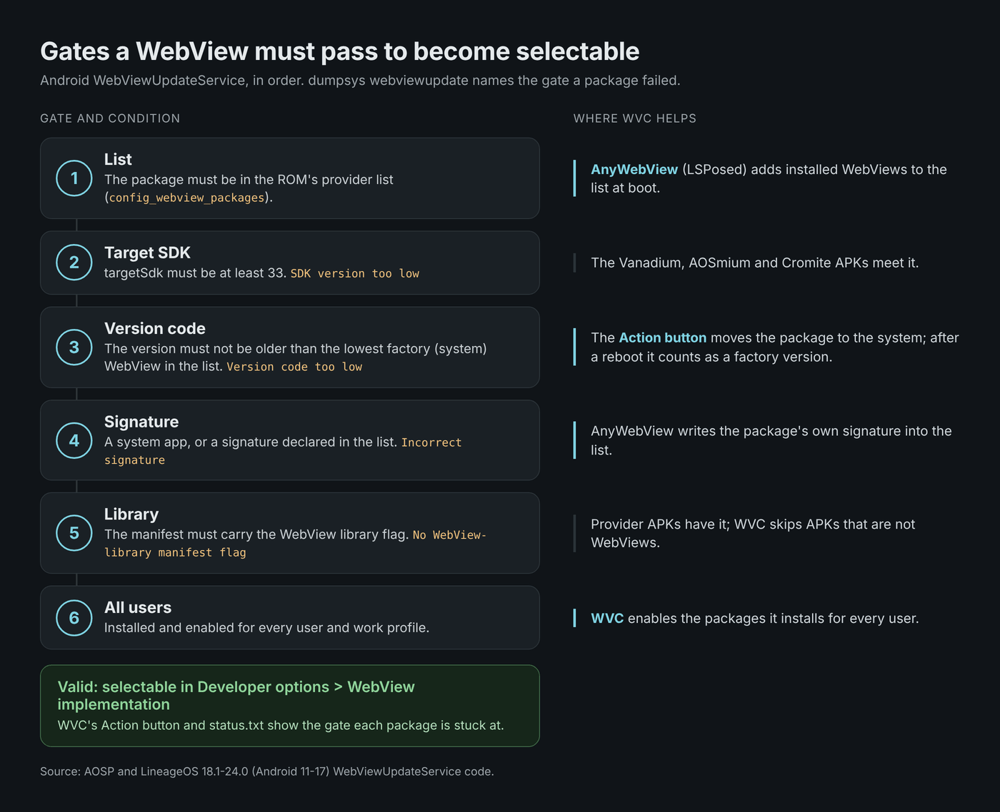
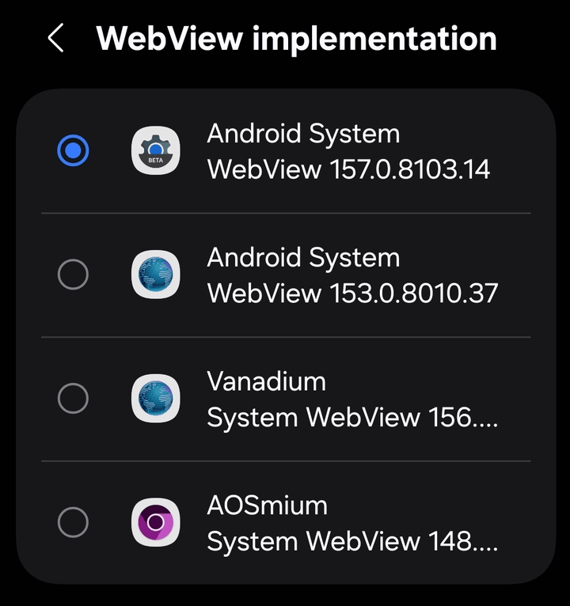
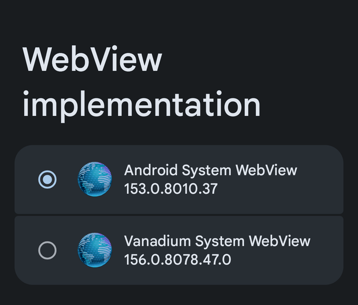
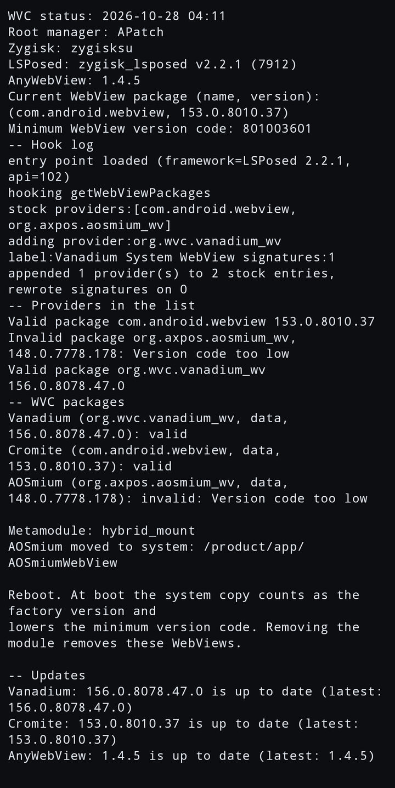
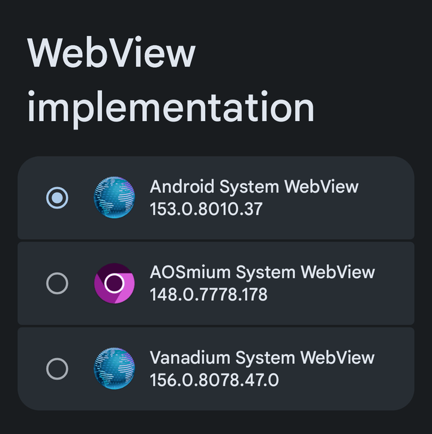

# Ways to use WVC

[Türkçe](rehber.md) · [README](../README.md)

Whether a WebView can be picked in **Developer options > WebView implementation** is decided by Android's WebViewUpdateService. A package has to pass six checks; `dumpsys webviewupdate` and WVC's Action button name the check a package failed.

WVC covers the first two stages below. The other three are not in WVC; they are listed so that the trade-offs are written down before any of them is built.

| Stage | What happens | Needs | Status |
|---|---|---|---|
| A | WVC installs the WebViews next to the stock one; AnyWebView adds them to the list | Zygisk, LSPosed, AnyWebView | In WVC since 9.1 |
| B | A, plus the Action button moves a package with `Version code too low` to the system | On KernelSU and APatch a metamodule | In WVC since 9.1, first tested inside the module with 9.4 |
| C | An overlay adds the providers to the list, without LSPosed | | Not in WVC, no decision yet |
| D | Google WebView is hidden | | Not in WVC, planned as an option for v10 |
| E | Chrome and Trichrome are hidden | | Not in WVC, planned together with D |

## A. Next to the stock WebView

WVC installs the APKs from `/sdcard/WVC` to `/data`. AnyWebView (LSPosed, scope **System Framework** only) adds the installed WebViews to the provider list at every boot. The stock WebView stays in the list, so you can switch back at any time.

Galaxy A8 2018 (jackpotlte), One UI port, Magisk, WVC 9.4. The ROM's list has six entries (the Google WebView channels and `com.android.webview`); AnyWebView appended Vanadium and AOSmium (`appended 2 provider(s) to 6 stock entries`). Google WebView, Cromite, Vanadium and AOSmium are valid.

- **Cost:** the added providers depend on the AnyWebView hook. If it does not load, only the ROM's own providers stay in the list. On a Mi Note 10 (tucana) on 2026-10-27, Zygisk Next had turned itself off, the hook log was empty and Vanadium was missing from the list; the stock WebView was still there.
- **Undo:** switch to the stock WebView, uninstall the packages (`pm uninstall org.wvc.vanadium_wv`, `org.axpos.aosmium_wv`, `com.android.webview` for Cromite), then remove the module. Removing only the module leaves the packages in `/data`, and AnyWebView keeps listing them. Android does not uninstall the active provider.
- **Tested on:** the devices in the [README](../README.md#tested-devices).

## B. Moving a package to the system

A package installed to `/data` can still fail the version check (gate 3): its version code must not be lower than the lowest factory version among the listed providers. On debuggable builds Android skips this check, so it shows up on user builds whose own WebView is newer than the package.

When the Action button finds `Version code too low`, it copies the package into the module as a system app (`/product/app/<name>`) and deletes the `/data` copy. After a reboot the system copy counts as a factory version and lowers the minimum.

POCO F1 (beryllium), BaikalOS 16.3 unofficial user build, FolkPatch with Hybrid Mount, WVC 9.4, 2026-10-28:

<table>
<tr>
<td width="33%" valign="top"><b>Before:</b> AOSmium is in the ROM's own list but invalid, so the picker hides it.  </td>
<td width="33%" valign="top"><b>Action:</b> minimum 801003601 (the ROM's WebView 153.0.8010.36), AOSmium 148.0.7778.178 too low, moved to <code>/product/app/AOSmiumWebView</code>.  </td>
<td width="33%" valign="top"><b>After a reboot:</b> minimum 777817801, AOSmium valid and selectable.  </td>
</tr>
</table>

In this run Cromite had taken the slot of the ROM's AOSP WebView (153.0.8010.37 in the list). The same steps with the stock WebView in place gave the same minimum before and after.

- **Needs:** on KernelSU and APatch an active metamodule that mounts the module's `system` folder (Hybrid Mount on this device). Not tested with Magisk.
- **Cost:** the system copy belongs to the module. Removing the module removes that WebView from the device, and the `/data` copy is already gone. The update check covers the system copy (`AOSmium: 148.0.7778.178 is up to date` after the move); installing an update over it has not been tested.
- **Undo:** remove the module and reboot. To use the package again, install it to `/data` with WVC; it will be `Version code too low` again.

## C, D and E: not in WVC

- **C. Overlay:** the Lordify-based WVC (before version 9) replaced the provider list with an overlay. Whether a ROM applies such an overlay depends on the ROM: on BaikalOS 16.3 and LineageOS 24 it did, on an unofficial LineageOS 23.0 build it did not (2026-10-23).
- **D. Hiding Google WebView:** expected, not measured: a hidden factory copy of Google WebView no longer sets the minimum version code, so stage B would not be needed on ROMs where Google WebView sets it. The cost: if the AnyWebView hook does not load, no valid provider may be left. Planned as an opt-in option for v10, to be tested first on a device with a recovery backup.
- **E. Hiding Chrome and Trichrome:** TrichromeLibrary is shared by Chrome and Google WebView, so hiding it breaks Chrome too. Planned as a separate option next to D.
