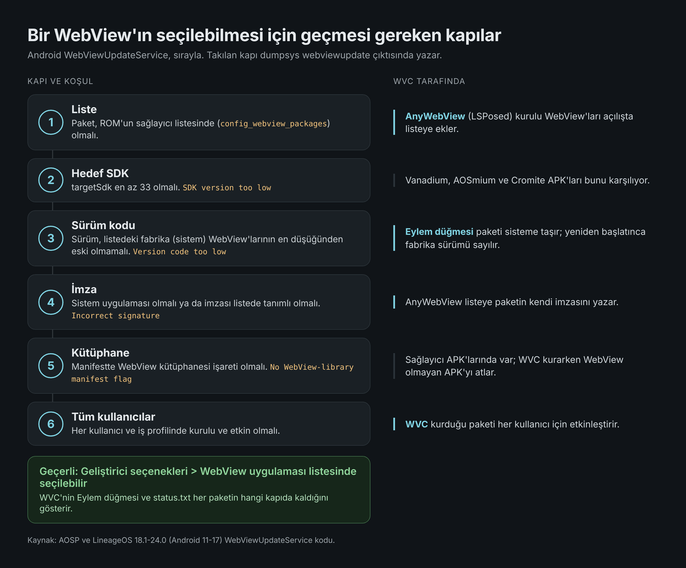
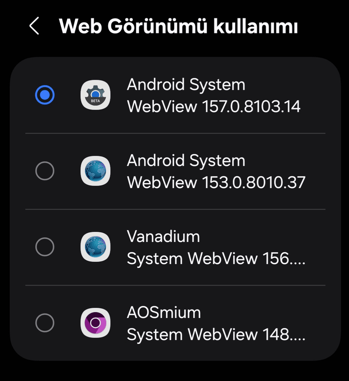
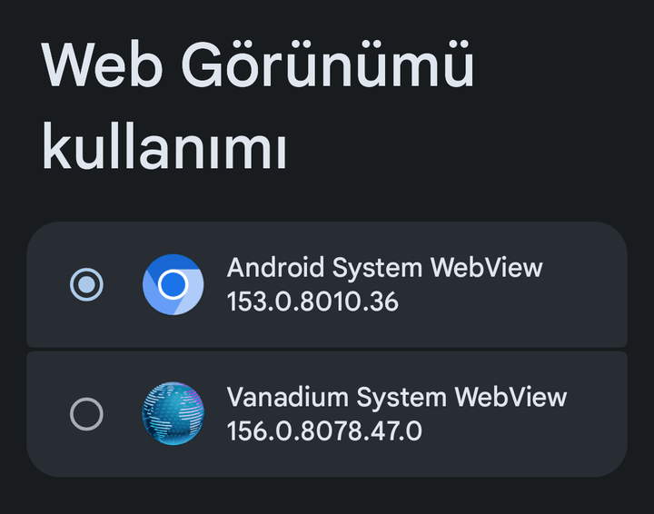
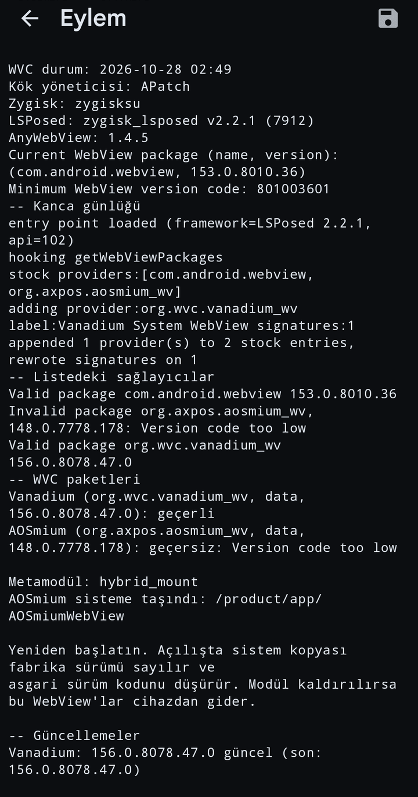
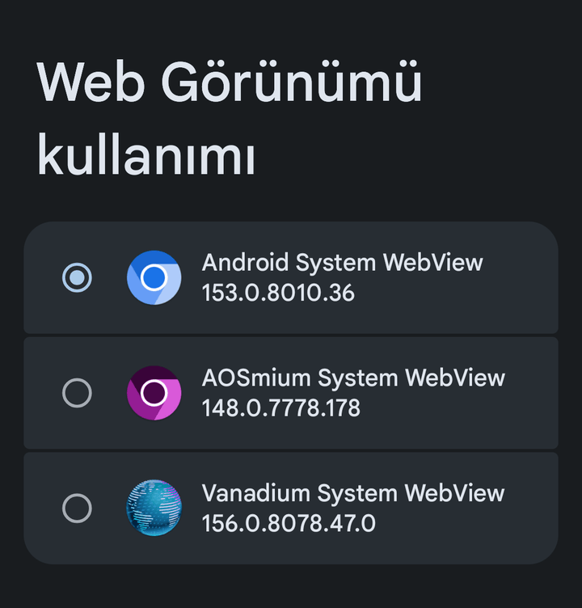

# WVC'yi kullanma yolları

[English](guide.md) · [README](../README.tr.md)

Bir WebView'ın **Geliştirici seçenekleri > WebView uygulaması** menüsünde seçilebilmesine Android'in WebViewUpdateService'i karar verir. Paket altı denetimden geçmelidir; `dumpsys webviewupdate` ve WVC'nin Eylem düğmesi paketin hangi denetimde kaldığını yazar.

WVC aşağıdaki aşamalardan ilk ikisini kapsar. Diğer üçü WVC'de yok; herhangi biri yazılmadan önce getirdikleri ve götürdükleri kayıtta dursun diye listelendi.

| Aşama | Ne olur | Gerekenler | Durum |
|---|---|---|---|
| A | WVC WebView'ları stok WebView'ın yanına kurar; AnyWebView onları listeye ekler | Zygisk, LSPosed, AnyWebView | 9.1'den beri WVC'de |
| B | A, ek olarak Eylem düğmesi `Version code too low` gösteren paketi sisteme taşır | KernelSU ve APatch'te bir metamodül | 9.1'den beri WVC'de, modülün içinden ilk kez 9.4 ile denendi |
| C | Sağlayıcıları listeye LSPosed olmadan bir overlay ekler | | WVC'de yok, karar verilmedi |
| D | Google WebView gizlenir | | WVC'de yok, v10 için seçenek olarak planlandı |
| E | Chrome ve Trichrome gizlenir | | WVC'de yok, D ile birlikte planlandı |

## A. Stok WebView'ın yanında

WVC `/sdcard/WVC` içindeki APK'ları `/data`'ya kurar. AnyWebView (LSPosed, kapsam yalnız **Sistem Çerçevesi**) kurulu WebView'ları her açılışta sağlayıcı listesine ekler. Stok WebView listede kalır; istediğiniz zaman ona geri dönebilirsiniz.

Galaxy A8 2018 (jackpotlte), One UI portu, Magisk, WVC 9.4. ROM'un listesinde altı girdi var (Google WebView kanalları ve `com.android.webview`); AnyWebView Vanadium ile AOSmium'u ekledi (`appended 2 provider(s) to 6 stock entries`). Google WebView, Cromite, Vanadium ve AOSmium geçerli.

- **Bedeli:** eklenen sağlayıcılar AnyWebView kancasına bağlı. Kanca yüklenmezse listede yalnız ROM'un kendi sağlayıcıları kalır. 2026-10-27'de bir Mi Note 10'da (tucana) Zygisk Next kendini kapatmıştı, kanca günlüğü boştu ve Vanadium listede yoktu; stok WebView yerindeydi.
- **Geri alma:** stok WebView'a geçin, paketleri kaldırın (`pm uninstall org.wvc.vanadium_wv`, `org.axpos.aosmium_wv`, Cromite için `com.android.webview`), sonra modülü kaldırın. Yalnız modülü kaldırmak paketleri `/data`'da bırakır ve AnyWebView onları listelemeye devam eder. Android etkin sağlayıcıyı kaldırmaz.
- **Denendiği cihazlar:** [README](../README.tr.md#test-edilen-cihazlar) tablosundakiler.

## B. Paketi sisteme taşıma

`/data`'ya kurulan bir paket sürüm denetiminde (3. kapı) yine kalabilir: sürüm kodu, listedeki sağlayıcıların fabrika sürümlerinin en küçüğünden düşük olmamalı. Android bu denetimi debuggable derlemelerde atlar; bu yüzden sorun, kendi WebView'ı paketten yeni olan user derlemelerde çıkar.

Eylem düğmesi `Version code too low` bulunca paketi modülün içine sistem uygulaması olarak (`/product/app/<ad>`) kopyalar ve `/data` kopyasını siler. Yeniden başlatınca sistem kopyası fabrika sürümü sayılır ve asgari değeri düşürür.

POCO F1 (beryllium), BaikalOS 16.3 resmi olmayan user derleme, FolkPatch ve Hybrid Mount, WVC 9.4, 2026-10-28:

<table>
<tr>
<td width="33%" valign="top"><b>Önce:</b> AOSmium ROM'un kendi listesinde ama geçersiz, seçim ekranı onu göstermiyor.  </td>
<td width="33%" valign="top"><b>Eylem:</b> asgari 801003601 (ROM'un WebView'ı 153.0.8010.36), AOSmium 148.0.7778.178 düşük, <code>/product/app/AOSmiumWebView</code> altına taşındı.  </td>
<td width="33%" valign="top"><b>Yeniden başlatınca:</b> asgari 777817801, AOSmium geçerli ve seçilebilir.  </td>
</tr>
</table>

İngilizce arayüzle yapılan ikinci denemede Cromite da kuruluydu ve ROM'un AOSP WebView'ının yerini almıştı (listede 153.0.8010.37). Asgari değer önce ve sonra aynı çıktı.

- **Gerekenler:** KernelSU ve APatch'te modülün `system` klasörünü bağlayan etkin bir metamodül (bu cihazda Hybrid Mount). Magisk'te denenmedi.
- **Bedeli:** sistem kopyası modülün parçası. Modül kaldırılınca o WebView cihazdan gider; `/data` kopyası zaten silinmişti. Güncelleme denetimi sistem kopyasını da kapsıyor (taşımadan sonra `AOSmium: 148.0.7778.178 güncel`); üzerine güncelleme kurmak denenmedi.
- **Geri alma:** modülü kaldırıp yeniden başlatın. Paketi yeniden kullanmak için WVC ile `/data`'ya kurun; yine `Version code too low` olur.

## C, D ve E: WVC'de yok

- **C. Overlay:** Lordify tabanlı WVC (9. sürümden önce) sağlayıcı listesini bir overlay ile değiştiriyordu. ROM'un böyle bir overlay'i uygulayıp uygulamadığı ROM'a bağlı: BaikalOS 16.3'te ve LineageOS 24'te uyguladı, resmi olmayan bir LineageOS 23.0 derlemesinde uygulamadı (2026-10-23).
- **D. Google WebView'ı gizleme:** beklenti, ölçülmedi: gizlenen fabrika Google WebView'ı asgari sürüm kodunu artık belirlemez; asgari değeri Google WebView'ın belirlediği ROM'larda B aşaması gerekmez. Bedeli: AnyWebView kancası yüklenmezse geçerli sağlayıcı kalmayabilir. v10 için isteğe bağlı seçenek olarak planlandı; ilk deneme kurtarma yedeği olan bir cihazda yapılacak.
- **E. Chrome ve Trichrome'u gizleme:** TrichromeLibrary Chrome ile Google WebView'ın ortak kütüphanesi; gizlenirse Chrome da çalışmaz. D'nin yanında ayrı bir seçenek olarak planlandı.
